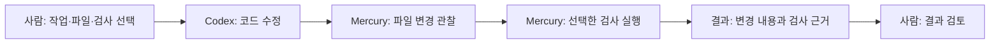

# Mercury

[Detailed English guide](README.en.md)

AI에게 코드 수정을 맡긴 뒤에도 **어떤 파일이 바뀌었는지, 사람이 선택한 검사가
실제로 통과했는지** 확인해야 합니다. AI가 작업을 끝냈다는 설명만으로는 이 두 가지를
알 수 없습니다.

Mercury는 사람이 정한 작업·파일 범위·검사 명령에 따라 코드 변경을 관찰하고 검사
결과를 모으는 로컬 Python 도구입니다. 사람이 결과를 검토할 근거를 제공합니다.
오프라인 시뮬레이터와 명시적으로 승인한
[일회용 저장소의 실제 Codex 예제](docs/codex-quickstart.md)를 실행할 수 있습니다.
임의의 사용자 저장소에 연결하려면 개발자가 Python 호출 코드를 구성해야 합니다.

## 현재 프로젝트 상태

Mercury는 버전 0.1.0의 단일 에이전트 Python API 개발자 프리뷰입니다.
이 진행 현황은 **2026-10-19**에
[main 5fd4b3d1](https://github.com/kssk3/Mercury/commit/5fd4b3d10f13f41ab7118bfe4648a576b104aecf)를
기준으로 정리했습니다. 해당 리비전에 반영된 기능을 설명하며, 일반 작업 실행 제품이나
출시 일정을 약속하지 않습니다.

| 기능 | 현재 상태 | 안내 |
| --- | --- | --- |
| 작업 계약, 범위·보호 입력 관찰, 필수 검사, 상태, 명시적 검증 이어가기 | Python API로 제공하며 호출자가 각 작업을 구성하고 승인 | [API 책임 범위](docs/quickstart.md#product-contracts-and-implementation) |
| 오프라인 시뮬레이터 | 네이티브 에이전트·모델 호출·계정 없이 사용 가능 | [오프라인 quickstart](docs/quickstart.md) |
| 실제 Codex 통합 예제 | [PR #3](https://github.com/kssk3/Mercury/pull/3) 반영 완료. 소유한 일회용 저장소에서 명시적으로 승인한 고정 작업 한 건 | [Codex quickstart](docs/codex-quickstart.md) |
| 읽기 전용 작업 계약 CLI | [PR #4](https://github.com/kssk3/Mercury/pull/4) 반영 완료. 문자열을 검증하고 JSON 출력 | [작업 계약 미리보기](#작업-계약-미리보기) |
| 읽기 전용 검증계획 CLI | [PR #5](https://github.com/kssk3/Mercury/pull/5) 반영 완료. 계약·필수 명령·완료 기준 매핑을 검증하고 JSON 출력 | [검증계획 미리보기](docs/quickstart.md#preview-a-verification-plan) |
| 읽기 전용 실행 기록 요약 CLI | [PR #6](https://github.com/kssk3/Mercury/pull/6) 반영 완료. 저장된 과거 상태·리비전·시도 ID·증거 참조를 JSON으로 요약 | [실행 기록 요약](#실행-기록-요약) |
| 실제 사용자 저장소 통합 예제 | [PR #7](https://github.com/kssk3/Mercury/pull/7) 반영 완료. 접근 권한이 필요한 `python_study`의 지정 리비전·덧셈 CLI 작업을 별도 사본에서 수행 | [제한된 저장소 예제](docs/python-study-example.md) |
| 공통 에이전트 계약 1단계 | [PR #8](https://github.com/kssk3/Mercury/pull/8) 반영 완료. `AgentAdapter`·`AgentTurnResult`로 준비·실행·결과 경계를 분리. 실제 제공 백엔드는 Codex이며 Claude·Gemini 어댑터는 없음 | [공통 계약](src/agent_harness/agent.py) |
| 임의의 사용자 저장소에서 일반 실행 | 개발자가 Python 호출 코드를 구성해야 하며 일반 설정 로더·작업 실행 CLI는 없음 | [실제 저장소와 에이전트 연결](#실제-저장소와-에이전트-연결) |

PR #3부터 PR #8까지 Merge됐고 소유한 작업 브랜치도 삭제됐습니다.
해당 리비전의 기존 자동 [main CI 실행](https://github.com/kssk3/Mercury/actions/runs/39189330048)은
정적 검사와 Linux 테스트를 포함해 성공했습니다. 이 현황에는 기존 통과 검사·리뷰를
재사용했으며, 진행 현황을 정리하기 위해 모델 작업이나 CI를 다시 실행하지 않았습니다.

## 어떤 문제를 돕나요?

**다음은 쇼핑 카트 통합을 가정한 설명이며 실행 가능한 튜토리얼이 아닙니다.**
가격 100에 10% 할인을 적용하면 90이 나와야 하는데 현재 코드가 80을 반환한다고
가정해 보겠습니다.

- 사람이 작업을 정합니다. 10% 할인 계산을 수정합니다.
- `cart.py`만 수정하도록 허용하고 `tests/test_cart.py`는 보호합니다.
- 검사로 `python -m pytest tests/test_cart.py`를 선택합니다.
- Codex가 코드를 수정하면 Mercury가 파일 변경을 관찰하고 선택한 검사를 실행합니다.
- 사람이 변경 파일과 실제 검사 결과를 검토한 뒤 작업을 받아들입니다.

이 저장소에는 위 쇼핑 카트 파일과 테스트가 없습니다. 위 명령은 여기서 실행하라는
안내가 아닙니다. 실제 Python 통합을 구성한 뒤의 개념적 흐름입니다.



AI의 설명은 실제 검사 결과를 대신하지 않습니다. 범위 관찰이 모든 원치 않는 수정을
막지는 않으며 Mercury는 보안 샌드박스를 제공하지 않습니다. 검증은 네이티브 작업 전에
호출자가 관리하는 외부 진입 프로그램과 선언된 shebang 인터프리터를 연결하고,
안전한 외부 실행 파일 및 일반 로더·시작 검색 경로를 고정합니다. 호출 프로그램은
전달된 환경을 따라야 합니다. 작업 공간의 명시적 실행·가져오기, 플러그인 검색,
프로그램별 설정, 의도적인 검색 경로 재정의는 호출자의 신뢰 결정으로 남습니다.

절대 인터프리터, 일반적인 `env program`, 따옴표 없는 단순 리터럴
`env -S program arguments`를 지원합니다. 따옴표·동적 확장·역슬래시·주석 방언,
비 ASCII env 문법과 env 검색 재정의는 배치의 명령을 실행하기 전에 거부합니다.
원래 스크립트 호출 방식과 명령 근거는 보존합니다. 리터럴 외부 `ENV`, `BASH_ENV`,
`PYTHONSTARTUP` 경로의 공백은 보존하고, Python home 쌍과 로더 목록은 각자의
구분자를 유지합니다. 호출자가 관리하는 런타임 의존성도 신뢰할 수 있어야 합니다.
진입 파일·인터프리터 확인은 크기가 제한된 일반 파일 읽기와 제한된 shebang 재귀를
사용하며, 외부 가상환경의 호출 방식도 보존합니다.

## 지금 사용해 보기: AI 없는 시뮬레이터

제공 예제는 쇼핑 카트 대신 작은 텍스트 파일을 사용합니다. 임시 Git 저장소의
`value.txt`를 `before`에서 `after`로 바꾸고, 변경되면 안 되는 `check.py`로 검사합니다.
**모의 Codex 어댑터의 Python 코드가 파일을 수정하며 네이티브 에이전트·모델·네트워크를
호출하지 않습니다.**

macOS, Git, Python 3.12 이상이 필요합니다. 아래 명령은 `python3.12` 실행 파일을
사용합니다. Codex CLI·모델 계정·API 키는 필요하지 않습니다. 저장소 다운로드와 패키지
설치에는 인터넷이 필요할 수 있지만 시뮬레이터 실행 자체는 오프라인입니다.

### 1. main 가져오기

빈 작업 위치에서 실행하세요. 예제가 포함된 브랜치를 명시적으로 선택합니다.

```sh
git clone --branch main --single-branch https://github.com/kssk3/Mercury.git mercury-demo
cd mercury-demo
```

`mercury-demo`에 문서·패키지 소스·`examples/quickstart.py`가 생성됩니다.

### 2. Python 환경과 패키지 준비

```sh
python3.12 -m venv .venv
.venv/bin/python -m pip install .
```

`.venv`에 독립된 Python 환경을 만들고 이 저장소의 `agent-harness` 패키지를 설치합니다.

### 3. 예제를 실행하고 결과 읽기

[예제 코드](examples/quickstart.py)를 읽고 실행하세요. `--approve-demo`는 이 임시 파일
수정과 검사만 승인하며 기존 저장소의 작업은 승인하지 않습니다. 이 플래그를 생략하면
임시 저장소를 만들기 전에 종료합니다.

```sh
.venv/bin/python examples/quickstart.py --approve-demo
```

성공하면 다음 JSON을 출력합니다.

```json
{"command_boundaries": 4, "criteria_passed": true, "mode": "simulated", "reason": "final_verification", "redaction_checked": true, "status": "pass"}
```

| 출력 | 의미 |
| --- | --- |
| `mode: simulated` | AI 없이 고정된 Python 시뮬레이터 코드가 파일을 수정함 |
| `status: pass`, `criteria_passed: true` | 선택한 완료 기준과 최종 검사가 통과함 |
| `reason: final_verification` | 수정 후 별도의 최종 검사로 결과를 다시 확인함 |
| `command_boundaries: 4` | 수정 전 검사·모의 수정·수정 후 검사·별도 최종 검사라는 네 경계를 지남 |
| `redaction_checked: true` | 예제의 합성 마커를 저장 전에 가림. 일반적인 비밀 탐지기는 아님 |

초기 `before` 값은 검사에 실패하고 모의 수정 뒤에는 통과합니다. 성공 시 종료 코드는
0입니다. 실패나 미확인 결과라면 상태·이유를 출력하고 0이 아닌 코드로 종료합니다.

예제가 끝나면 임시 Git 저장소와 그 외부에 저장한 임시 상태·출력을 삭제합니다.
다운로드한 `mercury-demo`와 설치한 `.venv`는 남습니다.
자세한 내용은 [quickstart](docs/quickstart.md)를 참고하세요.

## 실제 저장소와 에이전트 연결

현재 패키지는 단일 에이전트 Python API 개발자 프리뷰 `agent-harness` 0.1.0입니다.
초기 런타임 대상은 macOS이며 POSIX 프로세스·잠금 API가 필요합니다.
[CodexCLIAdapter](src/agent_harness/adapter.py)와
[run_loop](src/agent_harness/loop.py)는
[일회용 저장소의 실행 가능한 Codex 예제](docs/codex-quickstart.md)를 지원합니다.
이 예제는 고정 작업 한 건을 보여 줍니다. 임의의 사용자 저장소에서는
[전체 시뮬레이터 구성](examples/quickstart.py)과 아래 책임을 참고해 호출 코드를
구성해야 합니다. 설치된 CLI에는 일반 작업 실행 명령이 없습니다.

[python_study 예제](docs/python-study-example.md)는 접근 권한이 필요한 지정 저장소의
고정 작업을 별도 사본에서 수행하는 통합입니다. 임의 저장소 가져오기 기능은 아닙니다.
[공통 에이전트 계약](src/agent_harness/agent.py)은 신뢰하는 백엔드의 준비·실행·결과를
연결하며, 범위 관찰과 최종 검증의 책임은 하네스에 남습니다. 이 계약의 제공이
Claude·Gemini의 실제 실행 지원이나 자동 다중 에이전트 운영을 뜻하지는 않습니다.
기존 실제 Codex 실행 근거는 당시 후보에 해당하며, 이후 보완된 모든 코드를 실제
모델로 다시 실행했다는 의미는 아닙니다.

| 통합 시 제공할 항목 | 책임 |
| --- | --- |
| 작업과 실제 사람의 승인 | 허용·보호 파일과 의미 있는 완료 기준을 정합니다. [작업 계약](src/agent_harness/contract.py)·[승인 기록](src/agent_harness/admission.py) API를 사용합니다. 승인 기록 자체가 사람의 승인을 얻거나 인증하지는 않습니다. |
| 검사 | 검사·설정을 보호하고 필수 명령과 각 기준의 정확한 명령 매핑을 고정합니다. [검증 정책](src/agent_harness/policy.py)을 정의합니다. |
| 컨텍스트와 예산 | 선택한 파일 컨텍스트, 입력·출력 크기, 시간·재시도·명령 경계 한도 |
| 동시 작업과 상태 | 같은 저장소 호출자가 공유하는 잠금 임대, 필요한 heartbeat, 직렬화된 작업, 대상 저장소 외부의 상태·저널·출력 위치 |
| 에이전트와 출력 | 신뢰할 수 있는 Codex CLI·환경과 실제 출력 가림 정책. 어댑터는 재시도를 포함한 매 실행 전에 검증과 같은 제한된 확인으로 외부 진입 파일·선언된 shebang 체인을 검사하고 안전한 외부 검색 경로를 전달합니다. 기존 설정·규칙·인증과 관련 없는 환경은 유지됩니다. |

이 설정은 Python 입력이며 일반 설정 파일 로더는 없습니다. 명령 경계 예산은
네이티브 에이전트 내부의 개별 명령까지 제어하지 않습니다.

설치된 CLI는 다음 정보 명령을 제공합니다. `profile`은 Git 파일명 정보를 JSON으로
출력하며 작업 실행용 `run` 하위 명령은 없습니다.

```sh
.venv/bin/local-harness --help
.venv/bin/local-harness --version
.venv/bin/local-harness profile .
```

### 작업 계약 미리보기

설치 후 작업을 실행하지 않고 계약을 미리 볼 수 있습니다.

```sh
.venv/bin/local-harness contract --goal "Fix the total" \
  --allow missing/cart.py --protect missing/test_cart.py \
  --criterion "The total is correct"
```

```json
{"allowed_paths":["missing/cart.py"],"completion_criteria":["The total is correct"],"goal":"Fix the total","protected_paths":["missing/test_cart.py"]}
```

`--goal`과 하나 이상의 `--criterion`이 필요합니다. `--allow`, `--protect`,
`--criterion`을 반복하면 값을 추가하며 순서와 문자열은 보존됩니다. 생략한 경로 플래그는
빈 배열이 됩니다. 경로가 실제로 존재할 필요는 없습니다. 기존 TaskContract 검증은 빈
목표·기준, 절대 경로·부모 이동·Git 메타데이터·비정규 경로·중복 경로와 허용·보호 범위의
겹침을 거부합니다. 잘못된 입력은 stderr 오류와 종료 코드 2를 반환하고 JSON을 출력하지
않습니다. 올바른 입력은 종료 코드 0과 JSON 한 줄을 반환합니다.

미리보기는 문자열을 검증하고 네 필드 계약만 출력합니다. 저장소를 조사·변경하거나
승인·상태·잠금·baseline 기록을 만들지 않고 Git·에이전트·모델·네트워크·검사 명령을
호출하지 않습니다. 유효한 미리보기가 사람의 승인이나 완료 기준 통과 근거는 아닙니다.
임의 저장소 실행에는 여전히 Python 호출 통합이 필요합니다.

### 실행 기록 요약

이미 저장된 기록만 읽으려면 상태 디렉터리를 명시합니다.

```sh
.venv/bin/local-harness status --state-dir /absolute/path/to/external-state
```

`current.json`과 `events.jsonl`의 지원되는 종료 기록·연결을 읽어 JSON 한 줄을
출력합니다. `recorded_status`·`recorded_reason`·`attempt_ids`·`target_revision`,
간단한 검증 메타데이터와 증거 경로·다이제스트를 제공합니다. `historical_only: true`,
`current_workspace_verified: false`는 **과거 기록의 요약이며 현재 작업 공간의 검사나
진위·승인·Merge 가능 여부를 증명하지 않는다**는 뜻입니다. 원본 대화·stdout·stderr는
출력하지 않고 참조된 출력 파일도 읽지 않습니다.

읽을 수 있는 지원 기록은 과거 상태가 실패·차단이더라도 종료 코드 0입니다. 누락·손상·
지원하지 않는 형식·불일치·안전하지 않은 입력은 고정 진단과 `unknown` JSON을 출력하고
종료 코드 1을 반환합니다. 필수 플래그 누락 등 문법 오류는 종료 코드 2입니다.
각 파일은 일반 파일·단일 링크여야 하며 symlink 조상도 거부합니다. 크기 한도는
`current.json` 1 MiB, `events.jsonl` 8 MiB·10,000개 기록입니다. 이 한도는 새 요약
읽기에만 적용됩니다. 상태·저널·잠금 생성·변경, 저장소 관찰, Git·모델·검사·복구 실행은
하지 않습니다. 자세한 형식과 한계는 [기록 요약 안내](docs/quickstart.md#summarize-recorded-execution)를 참고하세요.

## 알아둘 한계

관찰은 특정 시점의 확인입니다. 무시된 미추적 파일과 Git 내부는 전체 파일 관찰 범위
밖에 있고 보호 입력은 호출자가 선택합니다. 프로세스 종료나 출력 저장만으로 기술적
PASS가 성립하지 않습니다. 선택한 검사의 통과가 모든 동작의 정확성을 증명하지 않으므로
검사 선택과 사람의 최종 검토가 필요합니다.

가리기 전 원문이 메모리에 남을 수 있습니다. 상태 저장·저널 순서는 fsync나 전원 장애
내구성을 보장하지 않습니다. 지원되는 체크포인트에서는 명시적 검증 이어가기가 가능하지만,
자동 네이티브 세션 복구·런타임 다중 에이전트 제어·메신저 제어는 현재 지원하지 않습니다.

## 제안하는 다음 우선순위

다음은 구현된 명령·승인된 후속 작업·출시 일정이 아닌 제안입니다. 각 작업에는 별도의
제한된 범위와 완료 기준이 필요합니다.

| 우선순위 | 제안 결과 | 순서의 이유 |
| --- | --- | --- |
| 다음 | 공통 계약의 백엔드 연결 방법 정리 | 기존 입력·결과·준비·실패 처리 책임을 재사용 가능한 안내로 명확히 설명 |
| 이후 | Codex 외 실제 백엔드 한 종류 연결 | 대상 CLI·결과 형식·인증·제한 시간을 먼저 확정하고 공통 계약에 맞춰 연결 |
| 그다음 | 최소 작업 실행 CLI와 설정 입력 | 승인된 계약·검사 계획·선택한 어댑터를 기존 루프에 연결 |

모델·스킬 비교와 추가 미리보기·런타임 리뷰 통합은 후속 탐색 방향입니다. 비교에는
같은 baseline·검사·예산의 고정 작업과 결과·실패·비용 근거가 필요합니다. 구조화된
리뷰 후보·지적은 증거와 위치에 연결해야 합니다. 자동 네이티브 세션 복구·런타임 다중
에이전트 제어는 계속 미지원이며 이번 작업 범위에 포함하지 않습니다.

## 기여와 라이선스

개발 검사와 피드백은 [CONTRIBUTING.md](CONTRIBUTING.md)를 참고하세요.
[MIT License](LICENSE)로 배포합니다. Copyright (c) 2026 Mercury (kssk3).
