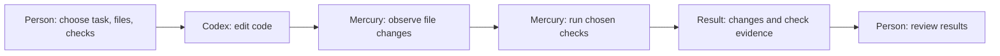

# Mercury

[Detailed English guide](README.en.md)

After asking AI to fix code, you still need to check two things: **which files
changed, and whether your chosen checks actually passed**. The AI's statement
that it is done does not answer those questions.

Mercury is a local Python tool that observes code changes and collects check
results for a task, file scope, and commands chosen by a person. It provides
evidence for that person's review. You can run an offline simulator or an
explicitly approved [real Codex example in a disposable repository](docs/codex-quickstart.md).
Connecting an arbitrary user repository still requires developer-written Python
caller integration.

## Current project status

Mercury is a single-agent Python API developer preview, version 0.1.0.
This progress snapshot was reconciled on **2026-10-14** against
[main at 719c45f0](https://github.com/kssk3/Mercury/commit/719c45f0d7480510aaa99dd1ec55cec14452b504).
It describes delivered capabilities on that revision, not a general task-running
product or a release commitment.

| Capability | Current state | Entry point |
| --- | --- | --- |
| Task contracts, scope/protected-input observations, required checks, state and explicit verification continuation | Available through the Python API; callers compose and approve each task | [API responsibility map](docs/quickstart.md#product-contracts-and-implementation) |
| Offline simulator | Available without a native agent, model call or account | [Offline quickstart](docs/quickstart.md) |
| Real Codex integration example | Delivered in [PR #3](https://github.com/kssk3/Mercury/pull/3); one explicitly approved fixed task in an owned disposable repository | [Codex quickstart](docs/codex-quickstart.md) |
| Read-only task-contract CLI | Delivered in [PR #4](https://github.com/kssk3/Mercury/pull/4); validates strings and prints JSON | [Contract preview](#preview-a-task-contract) |
| General execution on arbitrary user repositories | Requires developer-written Python caller integration; no general configuration loader or task-running CLI | [Integration responsibilities](#connect-a-real-repository-and-agent) |

PR #3 and PR #4 are merged, and their owned branches were removed.
The existing automatic [main CI run for this revision](https://github.com/kssk3/Mercury/actions/runs/38579592243)
completed successfully, including static checks, Linux tests and the offline
quickstart. Existing passed checks and reviews were reused to reconcile this
snapshot; documenting progress did not run another model task or CI cycle.

## What problem does it help with?

**This is a hypothetical shopping-cart integration story, not a runnable tutorial.**
Imagine a price of 100 with a 10% discount: the result should be 90, but the
current code returns 80.

- A person chooses the task: fix the 10% discount calculation.
- They allow edits to `cart.py` and keep `tests/test_cart.py` unchanged.
- For example, they choose `python -m pytest tests/test_cart.py` as the check.
- Codex edits the code; Mercury observes file changes and runs the chosen check.
- The person reviews the changed files and actual check results before accepting
  the work.

This repository does not provide those cart files or tests. The command above
is not an instruction to run it here. This is the conceptual path after a real
Python integration has been set up.



An AI explanation does not replace actual check results. Observing scope does
not prevent every unwanted edit, and Mercury does not provide a security sandbox.
Verification binds caller-managed external entry programs and declared shebang
interpreters before native work, and freezes safe external executable and common
loader/startup search paths. Caller programs must honor that supplied environment.
Explicit workspace execution, workspace imports, plugin discovery, program-specific
configuration and intentional search overrides remain caller trust decisions.
Absolute interpreters, conventional `env program`, and simple unquoted literal
`env -S program arguments` are supported. Quoting, dynamic expansion,
backslash/comment dialects, non-ASCII env syntax and env lookup overrides are
refused before any command in the batch launches. Native script invocation and
the original command evidence are preserved. Literal external `ENV`, `BASH_ENV` and
`PYTHONSTARTUP` paths preserve spaces; Python home pairs and loader lists retain
their own separators. Caller-managed runtime dependencies must remain trusted.
Entry and interpreter proofs use finite regular-file reads and bounded shebang
recursion. External virtualenv invocation is preserved.

## Try it today: a simulator with no AI

The provided example uses a small text file instead of a shopping cart. It
changes `value.txt` from `before` to `after` in a temporary Git repository and
checks it with `check.py`, which must stay unchanged. **Python code in a simulated
Codex adapter makes the edit; no native agent, model, or network is invoked.**

You need macOS, Git, and Python 3.12 or newer. The commands below use the
`python3.12` executable. You need no Codex CLI, model account, or API key.
Downloading the repository and installing the package may need internet access;
running the simulator itself is offline.

### 1. Get main

Run this from an empty working location. It explicitly selects the branch
containing the example.

```sh
git clone --branch main --single-branch https://github.com/kssk3/Mercury.git mercury-demo
cd mercury-demo
```

You will have the docs, package source, and `examples/quickstart.py` in `mercury-demo`.

### 2. Prepare Python and the package

```sh
python3.12 -m venv .venv
.venv/bin/python -m pip install .
```

This creates a separate Python environment in `.venv` and installs this
repository's `agent-harness` package there.

### 3. Run the example and read its result

Read [the example code](examples/quickstart.py), then run it. `--approve-demo`
approves only this temporary file edit and check; it does not approve work on an
existing repository. Omitting the flag exits before creating the temporary repository.

```sh
.venv/bin/python examples/quickstart.py --approve-demo
```

A successful run prints:

```json
{"command_boundaries": 4, "criteria_passed": true, "mode": "simulated", "reason": "final_verification", "redaction_checked": true, "status": "pass"}
```

| Output | Meaning |
| --- | --- |
| `mode: simulated` | Fixed Python simulator code changed the file, with no AI. |
| `status: pass`, `criteria_passed: true` | The chosen completion criterion and final check passed. |
| `reason: final_verification` | A separate check after the edit confirmed the result again. |
| `command_boundaries: 4` | The run crossed four boundaries: check before the edit, simulated edit, check after the edit, and a distinct final check. |
| `redaction_checked: true` | A synthetic example marker was masked before storage. This is not a general secret detector. |

The initial `before` value fails the check; it passes after the simulated edit.
Success returns exit code 0. If the run reports failure or an unconfirmed result,
it prints the status and reason and returns nonzero.

When the example ends, it deletes the temporary Git repository and its temporary
state/output stored outside that repository. Your downloaded `mercury-demo` and
installed `.venv` remain. See [the quickstart guide](docs/quickstart.md) for details.

## Connect a real repository and agent

The current package is `agent-harness` 0.1.0, a single-agent Python API developer
preview. macOS is the initial runtime target; POSIX process and locking APIs are
required. [CodexCLIAdapter](src/agent_harness/adapter.py) and
[run_loop](src/agent_harness/loop.py) support the
[runnable disposable Codex example](docs/codex-quickstart.md). It demonstrates
one fixed task; arbitrary user repositories require caller integration based on
[the full simulator composition](examples/quickstart.py) and the responsibilities
below. The installed CLI has no general task-running command.

| What your integration must supply | Responsibility |
| --- | --- |
| Task and actual human approval | Allowed/protected files and meaningful completion criteria. Use the [task contract](src/agent_harness/contract.py) and [admission record](src/agent_harness/admission.py) APIs; an admission record does not obtain or authenticate a person's approval. |
| Checks | Protected checks/configuration, frozen mandatory commands, and exact command mappings for each criterion. Define the [verification policy](src/agent_harness/policy.py). |
| Context and budgets | Selected file context, input/output sizes, time/retry/command-boundary limits |
| Concurrent work and state | A lock lease shared by callers on the same repository, heartbeat as needed, serialized work, and state/journal/output locations outside the target repository |
| Agent and output | A trusted Codex CLI and environment, plus a redaction policy for real output. Before each launch, including retries, the adapter checks the external entry and declared shebang chain using the same bounded proofs as verification and supplies safe external resolver paths. Existing configuration, rules, authentication, and unrelated environment remain active. |

These settings are Python inputs; there is no general configuration-file loader.
Command-boundary budgets do not control individual commands inside the native agent.

The installed CLI offers these information commands. `profile` emits Git filename
information as JSON; there is no task-running `run` subcommand.

```sh
.venv/bin/local-harness --help
.venv/bin/local-harness --version
.venv/bin/local-harness profile .
```

### Preview a task contract

After installation, preview a contract without running a task:

```sh
.venv/bin/local-harness contract --goal "Fix the total" \
  --allow missing/cart.py --protect missing/test_cart.py \
  --criterion "The total is correct"
```

```json
{"allowed_paths":["missing/cart.py"],"completion_criteria":["The total is correct"],"goal":"Fix the total","protected_paths":["missing/test_cart.py"]}
```

`--goal` and at least one `--criterion` are required. Repeat `--allow`,
`--protect`, and `--criterion` for additional values; their order and spelling
are preserved. Omitted path flags produce empty arrays. The paths need not exist.
The existing TaskContract validation rejects blank goals/criteria, absolute or
parent-traversing paths, Git metadata, noncanonical paths, duplicate paths,
and overlapping allowed/protected scope. Invalid input returns exit 2 with an
error on stderr and no JSON; valid input returns exit 0 with one JSON line.

Preview only validates strings and prints the four-field contract. It does not
inspect or modify a repository, create admission/state/lock/baseline records,
or invoke Git, agents, models, network calls, or verification commands. A valid
preview is neither human approval nor evidence that a criterion passed.
Arbitrary-repository execution still requires Python caller integration.


## Limits to understand

Observations are point-in-time checks. Ignored untracked files and Git internals
are outside aggregate observations, and the caller selects protected inputs.
Process exit or output storage alone does not establish technical PASS. Passing
the chosen checks does not prove that all behavior is correct; check selection
and final human review matter.

Raw text can remain in memory before redaction. State storage and journal ordering
provide no fsync/power-loss durability guarantee. Explicit verification continuation
exists for supported checkpoints, but automatic native-session recovery, runtime
multi-agent orchestration, and messenger control are not currently supported.

## Proposed next priorities

These are proposals, not implemented commands, approved work or release dates.
Each requires a separate bounded scope and acceptance criteria.

| Priority | Proposed outcome | Reason for this order |
| --- | --- | --- |
| 1 | Read-only verification-plan CLI | Connect the task contract to exact command arguments, working directory, timeout and completion-criterion mappings before execution |
| 2 | Read-only execution and review-evidence summary | Make attributable PASS, FAIL and UNKNOWN phase results and their evidence easier to inspect without starting another run |
| 3 | One bounded integration example for a real user repository | Establish explicit approval, trusted commands, protection, external state, lease and execution budgets for one concrete task |
| 4 | General execution CLI and configuration input | Expose repeated caller composition only after the real-repository contract is established |

Model/skill comparisons and additional preview/runtime review integrations remain
later exploration directions. Comparisons need fixed tasks with the same baseline,
checks and budgets, and attributable outcome, failure and cost records. Structured
review-candidate/finding artifacts should link evidence and locations. Automatic
native-session recovery and runtime multi-agent orchestration remain unsupported;
they are outside the proposed next task.

## Contributing and license

See [CONTRIBUTING.md](CONTRIBUTING.md) for development checks and feedback.
Licensed under the [MIT License](LICENSE). Copyright (c) 2026 Mercury (kssk3).
