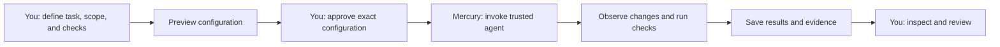

# Mercury

**A local reliability harness for coding agents.**

[Live demo](https://kssk3.github.io/Mercury/) ·
[Quick start](#quick-start) · [Run a real task](#run-a-real-task) ·
[Documentation](#documentation) · [Roadmap](docs/project/ROADMAP.md) ·
[MIT License](LICENSE)

A coding agent can say a task is finished while changing an unexpected file or
leaving a required check failing. You need evidence of what changed and which
checks passed before accepting the result.

Mercury runs a human-approved task through a trusted coding-agent CLI, observes
file changes, runs the checks you choose, and records the results. Inspect those
records as JSON or an offline HTML report, then decide whether to accept the work.

**Developer preview:** `agent-harness` 0.1.0, with a Python API and the
`local-harness` CLI. The initial runtime target is macOS; the harness requires
POSIX process and locking APIs. Start with the disposable offline simulator below:
it needs no agent installation, model account, or API key.

## Contents

- [What you can do](#what-you-can-do)
- [Quick start](#quick-start)
- [Run a real task](#run-a-real-task)
- [Inspect saved results](#inspect-saved-results)
- [Web walkthrough](#web-walkthrough)
- [How it works](#how-it-works)
- [Project structure](#project-structure)
- [Documentation](#documentation)
- [Limits and trust boundaries](#limits-and-trust-boundaries)
- [Development and contributing](#development-and-contributing)
- [License](#license)

## What you can do

| Capability | What it gives you |
| --- | --- |
| Define a bounded task | Choose allowed files, protected inputs, completion criteria, and required checks. |
| Preview before execution | Inspect the run configuration, its exact-byte SHA-256 digest, backend, and budgets without launching an agent or checker. |
| Connect a coding agent | Use a Codex CLI or Claude Code adapter through a common Python contract. |
| Verify the result | Observe scope changes and collect development checks plus a separate final verification. |
| Bound execution | Set time and output limits; use one turn by default or explicitly configure bounded retries. |
| Inspect retained evidence | Read historical status, candidate and verification identities, and explanations of missing evidence. |
| Export a report | Create JSON, standalone Korean HTML, and Markdown views of existing records in a fresh report directory. |

You supply the task, meaningful checks, trusted executables, and actual approval.
Mercury does not select acceptance criteria or automatically approve a change.
For delivered revisions and historical verification evidence, see the
[roadmap](docs/project/ROADMAP.md).

## Quick start

Run a small, disposable task without an AI model. The simulator changes
`value.txt` from `before` to `after` and verifies it with a protected `check.py`.
The edit is deterministic Python code; it is not a native agent run.

### Prerequisites

- macOS, Git, and Python 3.12 or newer.
- An internet connection for cloning and package installation if needed.
  The simulator itself runs offline.

### Install from source

From a directory where `mercury-demo` does not already exist:

```sh
git clone --branch main --single-branch https://github.com/kssk3/Mercury.git mercury-demo
cd mercury-demo
python3.12 -m venv .venv
.venv/bin/python -m pip install .
```

If you use a newer supported Python, replace `python3.12` with that executable.
This installs the `agent-harness` package and `local-harness` command into `.venv`.

### Run the simulator

Read the [example](examples/quickstart.py), then run:

```sh
.venv/bin/python examples/quickstart.py --approve-demo
```

`--approve-demo` admits only this temporary fixture edit and its checks. Without
the flag, the example exits before creating the temporary repository.

A successful run prints:

```json
{
  "command_boundaries": 4,
  "criteria_passed": true,
  "mode": "simulated",
  "reason": "final_verification",
  "redaction_checked": true,
  "status": "pass"
}
```

The four boundaries are the baseline check, simulated edit, development check,
and separate final check. `status: pass` describes the selected checks and
criteria. `redaction_checked` checks one synthetic marker, not general secret
detection. Success exits with code 0; unsuccessful or unknown results do not.

The temporary repository and its external state are removed afterward. Your
checkout and `.venv` remain. See the [quickstart guide](docs/quickstart.md) for
the API walkthrough and recorded cart scenarios.

## Run a real task

Install and authenticate your chosen agent separately, then prepare a clean Git
repository, a fixed expected HEAD, protected checkers, and external configuration
and state paths. Follow the [execution guide](docs/quickstart.md#execute-an-explicit-task)
to build the configuration; the path below is a placeholder for your prepared file.

```sh
.venv/bin/local-harness run --preview --config /absolute/external/run.json
```

Preview shows the settings and digest without creating runtime state or launching
an agent or checker. After reviewing them and separately authorizing execution:

```sh
.venv/bin/local-harness run --config /absolute/external/run.json \
  --approve-config-sha256 REVIEWED_64_CHARACTER_SHA256 --approver human-name
```

Replace the digest and approver placeholders with the reviewed digest and actual
approver. Do not automatically pipe the preview digest into execution. Changed
configuration bytes require a new approval. A valid preview does not prove that
runtime preflight or the task will succeed.

| Backend | Integration boundary |
| --- | --- |
| Codex CLI | Uses the trusted external CLI and retains its native configuration. Start with the [disposable Codex example](docs/codex-quickstart.md). |
| Claude Code | Uses the common adapter contract with a mandatory restricted/safe-mode boundary. User/project customizations are excluded; external authentication and managed policy remain trusted. Read the [backend limits](docs/quickstart.md#claude-code-backend-boundaries). |

By default, execution uses one turn and no retries. Retries require explicit
configuration and sufficient budgets before preview and approval; see
[bounded retries](docs/run-preview.md#explicit-bounded-retries).
The [JavaScript example](docs/quickstart.md#javascript-integration-example)
shows how a Python harness can use checks for another language.

## Inspect saved results

Use the external state directory from a previous run. These paths are
placeholders; the default quickstart removes its temporary state on completion.

```sh
# Read the historical result and optional metadata.
.venv/bin/local-harness status --state-dir /absolute/external/state --details

# Explain recorded verification and evidence gaps as JSON.
.venv/bin/local-harness status --state-dir /absolute/external/state --explain

# Emit a standalone Korean HTML report to stdout.
.venv/bin/local-harness status --state-dir /absolute/external/state \
  --explain --format html
```

These commands read saved records. They do not rerun checks or verify the current
workspace. A status command can exit successfully while reporting a historical
failure: its exit code describes whether the record was readable.

For explicit export of `explanation.json`, `report.html`, and `record.md`, follow the
[report-bundle guide](docs/validation-visibility.md#explicit-fresh-report-bundle).
Export writes a fresh projection of existing evidence; collecting a new external
check receipt is a separate, explicitly authorized operation.

## Web walkthrough

[Open the live homepage and cart demo](https://kssk3.github.io/Mercury/)
without installing anything. The walkthrough compares four outcomes of fixing
a coupon bug while preserving the existing shipping policy:

| Scenario | What the recorded evidence shows | Open the key evidence |
| --- | --- | --- |
| [Correct fix](https://kssk3.github.io/Mercury/#demo-correct) | Selected development and final checks pass, with no observed scope violation. | Passed checks |
| [Regression](https://kssk3.github.io/Mercury/#demo-regression) | The discount fix changes shipping behavior; a selected check fails. | Failed checks |
| [Scope violation](https://kssk3.github.io/Mercury/#demo-scope-escape) | A protected shipping-policy file changes outside the approved scope. | Approved scope and observed file changes |
| [Incomplete verification](https://kssk3.github.io/Mercury/#demo-incomplete) | Development checks pass, but final checks were not run; the result remains UNKNOWN. | Not-run and unknown checks |

Each result shows its conclusion, key evidence and next human decision, with a
button that opens the relevant evidence panel. Development and final summaries
separate passed, failed, not-run and unknown checks: an unrun check is not a
failed check, and missing evidence is not success.

Git diff shows code changes, tests check selected behavior, and CI reports its
configured workflow. Mercury connects the scope, check execution and interruption
records of a local agent task so you can review them together. It complements
those tools; it does not choose meaningful tests or automatically approve a merge.

The demo explores saved evidence from actual Mercury runs with deterministic
simulated edits and public synthetic inputs. It does not measure native AI
performance or launch an agent, run a checker, or contact a backend in the
browser. [Reproduce the recorded cart scenarios](docs/quickstart.md#recorded-cart-scenarios),
or use the [web development guide](web/README.md) to run the site locally.

With Node.js 24+ and npm, run from the repository root:

```sh
cd web
npm ci
npm run dev
```

Open <http://127.0.0.1:3000>. Python and AI credentials are not required for the
site. Web dependencies, checks, and static builds are managed separately from
the Python package; see the [web development guide](web/README.md).

## How it works



Mercury saves turn intent and observations, checks scope and protected inputs,
and records verification outcomes. Eligible final-verification records bind the
observed candidate to its verification evidence. Supported recovery and
verification-only continuation are explicit operations.

The [review-result API](docs/review-contract.md) assesses caller-supplied review
receipts against matching evidence. It does not authenticate the reviewer,
dispatch reviews, or automatically gate the execution loop, CLI, or GitHub.
Technical verification, review clearance, execution permission, and delivery
are separate facts. See the [architecture map](docs/project/ARCHITECTURE.md) for
module responsibilities and persistence boundaries.

## Project structure

```text
Mercury/
├── src/agent_harness/     # Python harness, CLI, adapters, evidence, and reports
├── examples/             # Offline and explicitly approved native examples
├── tests/                # Runtime, CLI, contract, and recovery tests
├── docs/                 # Usage guides and product contracts
│   └── project/          # Roadmap, architecture, and contributor workflow
├── scripts/              # Development and source-verification helpers
├── web/                  # Independent introduction site and walkthrough
├── pyproject.toml        # Python package and development configuration
└── uv.lock               # Locked Python dependency resolution
```

## Documentation

| I want to… | Start here |
| --- | --- |
| Understand the simulator and Python APIs | [Quickstart](docs/quickstart.md) |
| Preview and approve a real task | [Run configuration](docs/run-preview.md) |
| Try a fixed task with native Codex | [Codex quickstart](docs/codex-quickstart.md) |
| Inspect saved process and verification metadata | [Status details](docs/status-details.md) |
| Explain evidence or export an offline report | [Validation visibility](docs/validation-visibility.md) |
| Understand candidate identities and review receipts | [Review contract](docs/review-contract.md) |
| Check delivered, held, and proposed work | [Roadmap](docs/project/ROADMAP.md) |
| Find the modules behind a behavior | [Architecture](docs/project/ARCHITECTURE.md) |
| Develop or contribute | [Contributing](CONTRIBUTING.md) and [project workflow](docs/project/WORKFLOW.md) |

## Limits and trust boundaries

- **Scope observation is not a security sandbox.** Checks are point-in-time;
  they do not prevent concurrent changes or cover every ignored file and Git
  internal. Choose protected inputs deliberately.
- **Verification is only as meaningful as the selected checks.** A native
  process exiting successfully or producing output does not establish task PASS.
  Historical evidence does not verify today's workspace or prove a fresh model run.
- **Native tools remain trusted dependencies.** Executable and interpreter
  checks preserve declared boundaries, but plugins, runtime dependencies, and
  applicable native settings still require a caller trust decision.
- **Execution budgets are not billing guarantees.** Command boundaries and
  time/output limits do not count every internal model turn, token, or command.
- **Recovery is explicit and bounded.** There is no automatic native-session
  resume, automatic rollback, or guarantee of power-loss durability.
- **Review and delivery remain separate.** Mercury does not provide general
  multi-agent orchestration, automatic repository onboarding, or automatic merge.
  Contributor review rules are not automatically installed as product behavior.
- **Review reports before sharing.** Saved records can contain local paths and
  operator identifiers. Export is not automatic privacy scrubbing.

## Development and contributing

Use Python 3.12+, Git, and uv. From the repository root:

```sh
uv sync --locked --dev
```

Follow [CONTRIBUTING.md](CONTRIBUTING.md) for the required schema, test, lint,
formatting, typing, and example checks. The [project workflow](docs/project/WORKFLOW.md)
defines scoped changes, independent review, and authorized delivery. Web checks
are documented separately in [web/README.md](web/README.md).

For bug reports, include a minimal reproduction and expected versus observed
behavior, with credentials, private paths, and native transcripts removed.

## License

[MIT License](LICENSE). Copyright (c) 2026 Mercury (kssk3).
