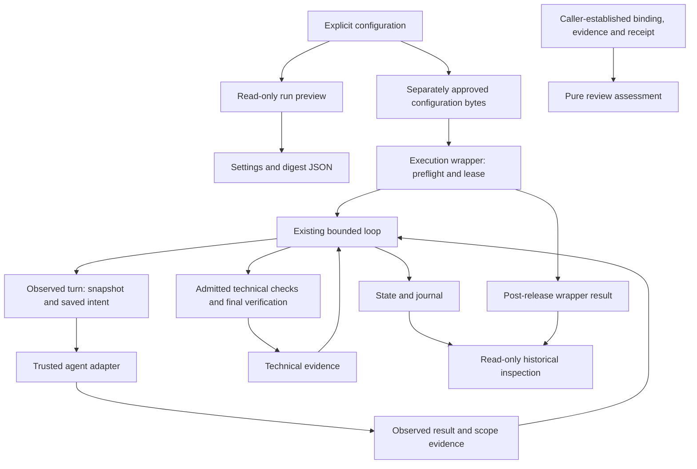

# Mercury architecture

Documentation date: 2026-10-24. This map describes product code at
[main f6343844](https://github.com/kssk3/Mercury/commit/f63438440f77c3eca177399bc5c7d0bcbd985a5d).
It is a responsibility map of existing modules, not a new package layout or
dependency policy. [WORKFLOW.md](WORKFLOW.md) owns repository lifecycle;
[ROADMAP.md](ROADMAP.md) separates delivered, local, held and planned outcomes.

## Product execution and authoring environment

Mercury's Python package starts an admitted task through a trusted Codex or
Claude CLI adapter, observes scope, executes chosen verification commands and
records evidence. Its implementation language does not restrict the checker to
Python. The caller supplies meaningful commands for the target language.

The tools used to develop Mercury have a separate control plane: personal
skills, authoring-app hooks, repository AGENTS, human decisions and GitHub
delivery checks. They are not automatically installed or enforced by Mercury's
product adapters. Separate Codex/Claude apps need no cmux handoff dependency.
An AGENTS file guides decisions; tool permissions and sandboxing have their own
actual enforcement boundaries.

## Main entry paths

The diagram separates the unintegrated review API from execution. A preview
does not supply approval. Historical inspection does not run recovery or verify
the present workspace. Detailed user-facing contracts are in the
[quickstart responsibility map](../quickstart.md#product-contracts-and-implementation),
[run preview](../run-preview.md) and [review contract](../review-contract.md).

## Module responsibilities

Paths below are existing modules, not proposed services or agent roles.

| Responsibility | Modules | Boundary |
| --- | --- | --- |
| CLI and repository inventory | [cli.py](../../src/agent_harness/cli.py), [profile.py](../../src/agent_harness/profile.py) | Route commands and collect filename-based Git information. Repository inventory is not technical verification. |
| Approved execution configuration | [run_config.py](../../src/agent_harness/run_config.py), [task_run.py](../../src/agent_harness/task_run.py) | Parse/preview bounded settings; reload approved bytes, preflight repository/state/checkers, hold the lease, compose the loop and finalize the wrapper result. |
| Task and admission contracts | [contract.py](../../src/agent_harness/contract.py), [admission.py](../../src/agent_harness/admission.py), [amendment.py](../../src/agent_harness/amendment.py), [command_admission.py](../../src/agent_harness/command_admission.py) | Represent admitted scope, criteria and command/contract decisions. Recorded approval is not identity authentication. |
| Repository, workspace and protected inputs | [repository.py](../../src/agent_harness/repository.py), [workspace.py](../../src/agent_harness/workspace.py), [scope.py](../../src/agent_harness/scope.py), [integrity.py](../../src/agent_harness/integrity.py), [baseline.py](../../src/agent_harness/baseline.py) | Establish repository identity, path/scope observations and protected fingerprints without claiming hostile-process confinement. |
| Common and native adapter boundaries | [agent.py](../../src/agent_harness/agent.py), [adapter.py](../../src/agent_harness/adapter.py), [claude_adapter.py](../../src/agent_harness/claude_adapter.py), [native_output.py](../../src/agent_harness/native_output.py) | Prepare/run a trusted backend, validate process/result facts and retain bounded native output. Task success remains a harness decision. |
| Context and stored text | [context.py](../../src/agent_harness/context.py), [output.py](../../src/agent_harness/output.py) | Select bounded context and apply the caller's output-storage/redaction policy. Raw adapter text can exist before redaction. |
| Technical verification | [policy.py](../../src/agent_harness/policy.py), [runner.py](../../src/agent_harness/runner.py), [development.py](../../src/agent_harness/development.py), [final.py](../../src/agent_harness/final.py), [evidence.py](../../src/agent_harness/evidence.py) | Bind required commands and trusted programs, collect bounded command results, decide technical outcomes and preserve protected-input failures. |
| Execution, retry and escalation decisions | [execution.py](../../src/agent_harness/execution.py), [retry.py](../../src/agent_harness/retry.py), [escalation.py](../../src/agent_harness/escalation.py) | Represent decisions over admitted execution facts/limits. In particular, execution.py makes pure state transitions; it does not execute or persist work. |
| Turn and loop composition | [turn.py](../../src/agent_harness/turn.py), [loop.py](../../src/agent_harness/loop.py) | Order snapshots, saved intent, preparation, execution, scope checks, verification, terminal records and supported explicit continuation. |
| Persistence and checkpoint facts | [state.py](../../src/agent_harness/state.py), [journal.py](../../src/agent_harness/journal.py), [attempt.py](../../src/agent_harness/attempt.py), [verification_checkpoint.py](../../src/agent_harness/verification_checkpoint.py) | Store current/journal/attempt projections and serialize supported checkpoint facts. A checkpoint alone does not authorize continuation. |
| Startup, recovery and failure evidence | [startup.py](../../src/agent_harness/startup.py), [recovery.py](../../src/agent_harness/recovery.py), [interruption.py](../../src/agent_harness/interruption.py), [failure.py](../../src/agent_harness/failure.py) | Reconcile or classify retained evidence and support explicitly requested file recovery. Reports do not resume native sessions or create completion authority. |
| Cooperative serialization | [lock.py](../../src/agent_harness/lock.py) | Repository lease and heartbeat; callers must coordinate on the same state location and compatible horizon. |
| Historical presentation | [inspection.py](../../src/agent_harness/inspection.py) | Read supported state/journal/wrapper bindings without executing the task, referenced outputs or recovery. |
| Review-result assessment | [review.py](../../src/agent_harness/review.py) | Validate receipt shape and compare caller-established binding/evidence. It performs no I/O, digest production, authentication or reviewer dispatch. |
| Development schema and package surface | [schema_validation.py](../../src/agent_harness/schema_validation.py), [__init__.py](../../src/agent_harness/__init__.py) | Development-only synthetic status validation and package version/surface; neither establishes delivery or replaces runtime evidence. |

## Execution ordering and invariants

1. The caller chooses the task, protected checker, commands, budgets and actual
   authorization. The CLI's configuration digest binds bytes, not a person's
   identity. The Python API requires caller-owned admission and serialization.
2. The execution wrapper reloads approved configuration bytes and uses that
   independent snapshot. It checks baseline/protected inputs around acquisition
   of its repository lease before composing the loop.
3. An actual turn captures its before state and saves intent before adapter
   preparation. Preparation belongs to that turn, including observed mutations;
   compatibility checks and verification-only continuation do not prepare again.
4. Native process/result facts are validated before downstream recording. An
   output artifact or successful exit alone is not scope clearance or technical
   PASS. The loop runs admitted technical phases and maps every criterion to
   exact commands, including a distinct final verification.
5. Current state, attempt projections and terminal journal records preserve
   observed outcomes. CLI wrapper records also need post-release finalization;
   incomplete or inconsistent supported records remain UNKNOWN to readers.

Preserve these existing boundaries through the cross-cutting
[R1-R4 review rules](../../AGENTS.md#code-review-rules). They are product
invariants, not new repair/review/publication allowances.

## Persistence and consumer ownership

When a future contract changes stored identity or event/result shape, trace the
existing producer and consumers rather than adding a parallel store or universal
parser. Distinct trust boundaries can require distinct validation.

| Stored contract | Producer/serialization owners | Consumers to assess together |
| --- | --- | --- |
| Turn intent, observed process/output and attempt phases | turn.py, loop.py, attempt.py, journal.py, state.py | startup.py reconciliation; interruption.py/failure.py projections; verification_checkpoint.py and loop.py continuation; inspection.py supported histories |
| Loop summary and CLI wrapper binding/finalization | loop.py and task_run.py with current/journal projections | inspection.py and supported startup/continuation logic; keep direct-loop/older record handling explicit |
| Sealed file-recovery evidence | recovery.py capture/seal and caller-retained trusted references | recovery.py loading/preflight/recovery; reconcile relevant live state separately before any continuation |
| Review binding and receipt | review.py defines records; the trusted caller currently establishes content/evidence identities | assess_review compares supplied facts; persistence and runtime/CLI presentation are proposed work, not an existing integration |

See the [next binding outcome](ROADMAP.md#p1-bind-execution-results-to-the-actual-review-target)
before designing that integration. Existing evidence reuse depends on relevant
content, base, tool and environment applicability under WORKFLOW, not merely an
unchanged Git HEAD.

## Trust and capability limits

- Trusted native executables and declared interpreter proofs are checked through
  invocation/retry boundaries. Arbitrary plugins, runtime dependencies and
  native settings remain part of the admitted trust decision.
- Codex retains its native configuration. The Claude backend uses its mandatory
  restricted/safe-mode boundary and excludes user/project customizations; external
  authentication and managed policy remain trusted. See
  [backend limits](../quickstart.md#claude-code-backend-boundaries).
- Scope observations cover tracked and nonignored untracked paths. They do not
  cover every ignored entry or Git internal, and they are not an OS sandbox or
  atomic protection against concurrent changes. Protected inputs are explicit.
- Native/command timeouts and retained-byte budgets are separate from internal
  model turns, tokens and billing. Cooperative leases are not hostile-process
  locks; preflight/cleanup also have their own timing boundaries.
- Journal ordering and recovery evidence do not promise automatic rollback,
  automatic native-session resume or fsync/power-loss durability.
- A review receipt cannot authenticate its references or make technical failure
  pass. Technical verification, review clearance, execution permission and actual
  delivery remain separate. GitHub merge/status workflows govern development of
  this repository; they are not an automatic product integration.

Tests and existing PASS evidence describe their recorded candidate/environment.
The linked [development checks](../../CONTRIBUTING.md) were not executed to
produce this documentation update. Held PR #12 and proposed roadmap items do not
change the pinned implementation described here.
